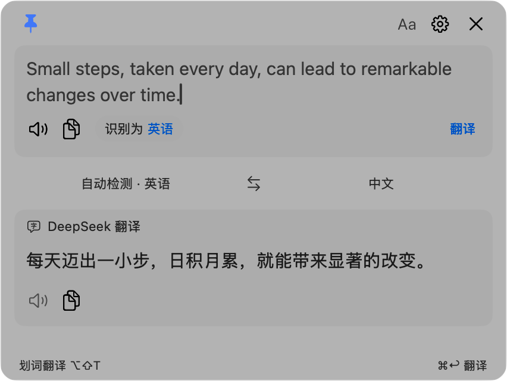
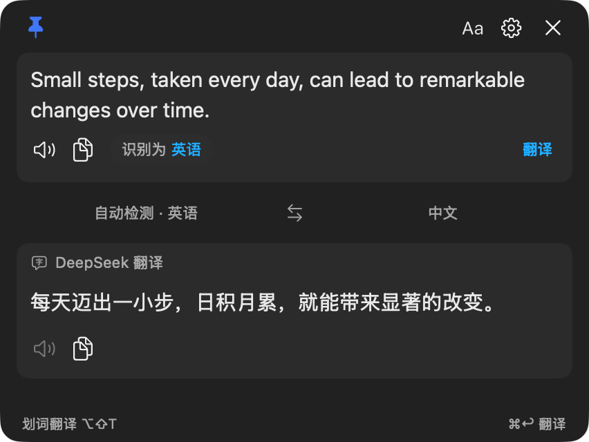
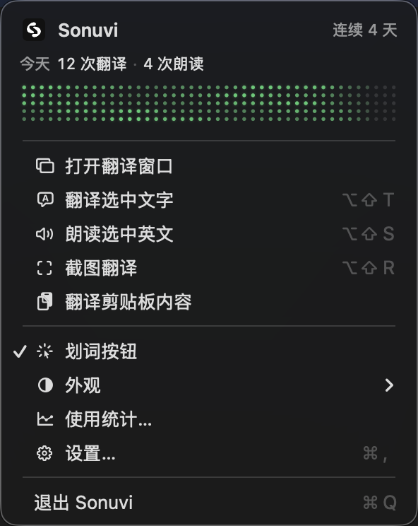
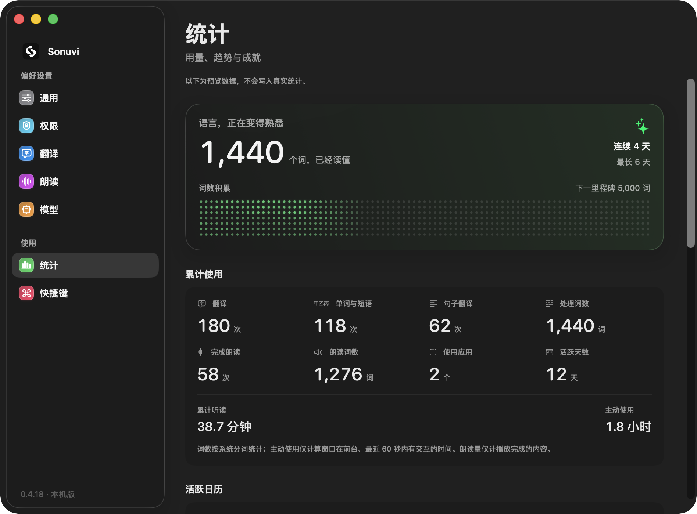
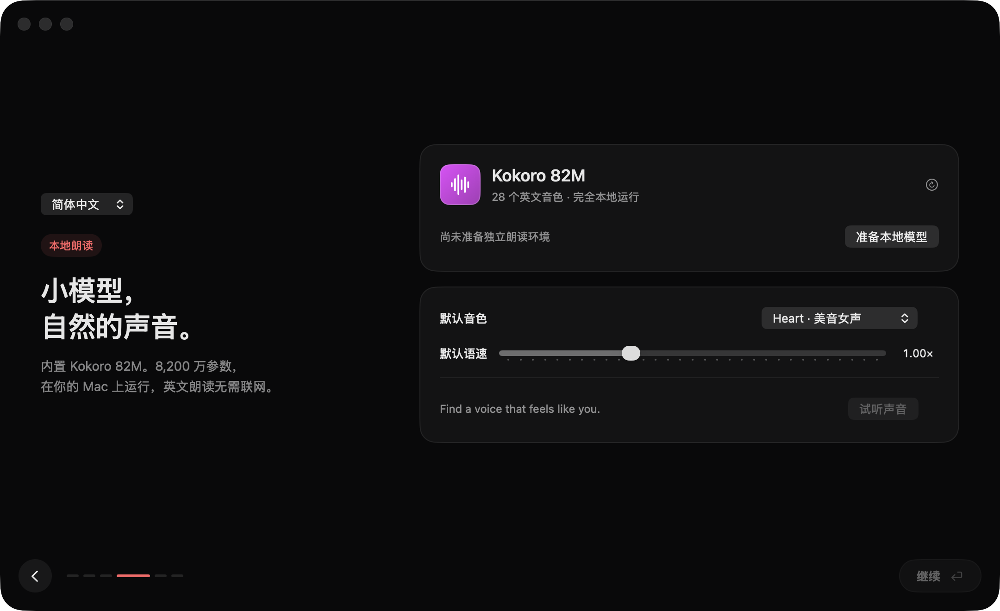
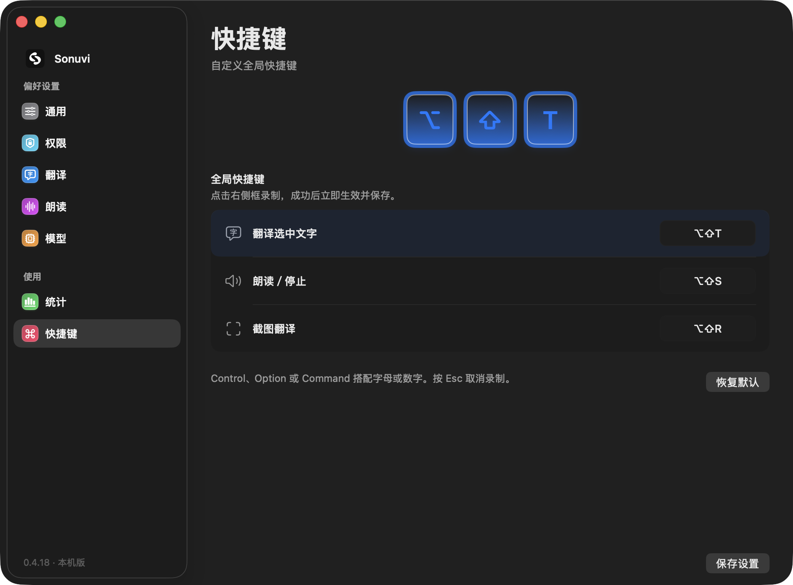
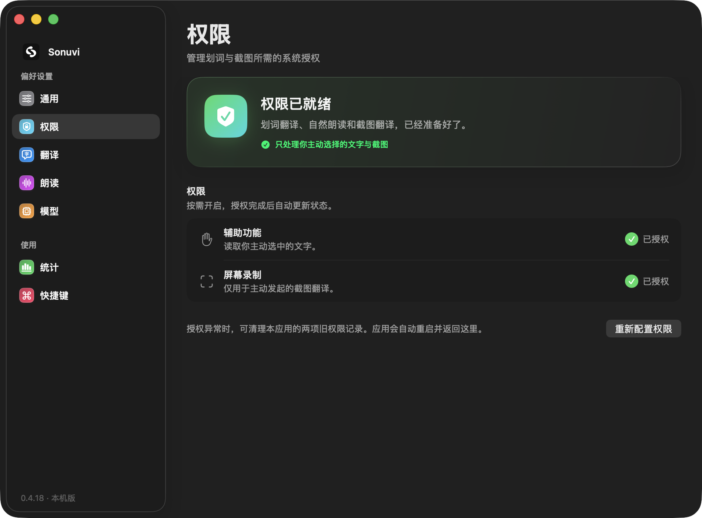

<div align="center">


# Sonuvi

### 选中英文，让它自然读给你听。

一个住在 Mac 菜单栏里的朗读伙伴。<br />
用本地小模型听英文，用划词与截图翻译读懂它。


<!-- sonuvi-download:start -->
**[下载翻译版 · 14.8 MB](https://github.com/davidai1024/Sonuvi/releases/download/v0.4.45/Sonuvi-Mac.dmg)** · **[下载翻译＋朗读版 · 461 MB](https://github.com/davidai1024/Sonuvi/releases/download/v0.4.45/Sonuvi-Mac-Offline.dmg)**

Apple Silicon（M 系列芯片） · macOS 14.0 及以上 · v0.4.45

两个版本功能相同。轻量版未内置朗读模型，可随时在「设置 → 模型」免费下载约 505 MB 的本地语音资源；完整朗读版已内置模型、运行环境和 28 个英文音色，无需另行下载。模型准备好后，英文朗读免费且可离线使用。已有模型会保留，可单独更新。

[版本与更新说明](https://github.com/davidai1024/Sonuvi/releases/tag/v0.4.45)
<!-- sonuvi-download:end -->

[官方网站](https://sonuvi.davidai1024.com/) · [使用教程](https://sonuvi.davidai1024.com/learn/) · [28 种音色试听](https://sonuvi.davidai1024.com/learn/voices/) · [English guides](https://sonuvi.davidai1024.com/en/learn/)

[下载与安装](#下载与安装) · [界面预览](#界面预览) · [功能](#先听再理解) · [开始使用](#开始使用) · [快捷键](#常用快捷键) · [更新记录](CHANGELOG.md) · [源码构建](#从源码构建)

</div>

---

## 让阅读不必停在一个单词上

读文章、看文档、学英语时，选中一段英文，Sonuvi 就能用自然的声音读出来。无需把文字搬到另一个网站，也不必一直盯着翻译窗口。

**朗读由本机 Kokoro 82M 完成，翻译通过你自己的 DeepSeek API。** 英文朗读可以离线使用；中文选区也能先翻译成英文，再听英文表达。

- **28 个英文音色**：20 个美音、8 个英音，支持试听和 0.5–2 倍语速。
- **长文接着听**：优先按句子分段，播放当前段时提前合成下一段，减少等待。
- **一个轻量浮条**：跨应用朗读时只显示可拖动的播放浮条，停止或读完即收起。
- **声音有了形状**：16 列点阵根据实际音频频谱上下跳动，停顿时回落。
- **按需下载模型**：App 与语音资源分别发布。首次下载后可离线朗读，模型更新无需重装 App；已有模型继续复用。

> 下载最新版请使用页首按钮，版本、大小与最低系统要求以页首下载信息为准。建议至少预留 **3 GB** 空间。基础界面源码的最低部署版本与捆绑朗读环境的系统要求不同。

## 界面预览

以下图片来自 **0.4.18 的原生界面**。文字、统计与播放状态使用演示数据；静态截图无法完整呈现玻璃材质和点阵动画。

### 朗读时，只留一条轻量浮条

<div align="center">

</div>

跨应用听英文时，不打开翻译窗口。点阵随声音起伏，读完或停止后自动收起。

### 原文与译文，保留阅读的主次

<table>
<tr><td align="center"><strong>浅色</strong></td><td align="center"><strong>深色</strong></td></tr>
<tr>
<td width="50%"></td>
<td width="50%"></td>
</tr>
</table>

### 常用操作在菜单里，使用进展看得见

<table>
<tr><td width="34%" valign="top"></td><td width="66%" valign="top"></td></tr>
</table>

### 把第一次使用，也认真做好



<table>
<tr><td align="center"><strong>快捷键 · 清晰的录制状态</strong></td><td align="center"><strong>权限 · 独立管理与状态反馈</strong></td></tr>
<tr><td width="50%"></td><td width="50%"></td></tr>
</table>

## 先听，再理解

| 能力 | 使用方式 |
| :--- | :--- |
| **跨应用取词** | 选中文字后调用浮动菜单或全局快捷键。兼容性取决于目标应用是否提供可读取的文字。 |
| **自然英文朗读** | 本地 Kokoro 82M 合成；后台预热、常驻服务、长文提前合成下一段。 |
| **两种播放位置** | 跨应用操作显示浮条；翻译窗口内发起朗读，直接在窗口底部显示点阵与停止按钮。 |
| **中英自动互译** | 中文译英文、英文译中文，无需来回切换方向。 |
| **词典与句子模式** | 单词、短语展示释义、词性、音标和例句；句子展示流式译文。 |
| **截图翻译** | 原生框选区域，本机 OCR 识别，再翻译识别出的文字；先展示识别状态。 |
| **系统服务** | 在支持文本服务的应用中，通过右键 → 服务调用翻译和朗读。 |
| **长文本阅读** | 原文按内容增高，到上限后滚动；向下阅读时保留返回原文入口，滚动条使用细滑块。 |
| **复制与编辑** | 原文、译文和例句可复制；支持常用键盘编辑操作。 |
| **原生界面** | 深浅色、可调整窗口、原生标题栏；macOS 26 使用液态玻璃，旧系统采用原生材质。 |
| **中英界面** | 简体中文、English、跟随系统；默认跟随系统。 |
| **快捷键录制** | 选中对应操作，按键预览同步点亮；松键保存，Esc 或点击外部取消。设置与引导使用同一组件。 |
| **应用例外** | 按应用控制是否显示划词菜单，开启即显示，关闭即隐藏。 |
| **本地统计** | 翻译、朗读、词数、时长、应用、活跃天数、每日趋势与成就进度。 |

## 0.4.29

- 修复原文包含提示词、任务指令或推理记录时，模型回答原文而非翻译的问题；翻译请求保持非思考模式。
- 长文本自动分段翻译，支持最多 20 万字符；划词、快捷键、粘贴、系统服务与浏览器连接使用一致的输入上限。
- 显示分段进度；中断时保留已完成译文，重试从未完成段继续，输出过长时自动细分当前段。
- 延长显式复制读取等待时间，并减少长译文流式显示时的重复语言检测和刷新。

## 0.4.28

- 修复引导权限页隐藏恢复区域仍占高度、导致右侧内容偏上的问题。
- 恢复提示按实际内容撑开，中英文完整窗口验证可见内容垂直对齐。

## 0.4.27

- Chrome / Edge 浏览器扩展支持在主右键菜单中翻译或朗读所选文字；首次需手动加载，并在设置 → 通用中启用连接。
- 键盘使用 ⌘A、Shift＋方向键选中文字后，也能显示划词快捷操作。
- 开发预览包不再注册系统服务，避免旧预览在服务菜单中产生重复项。

## 0.4.26

- API Key 已配置时只显示脱敏字符，替换与删除收进更多菜单。
- Kokoro 名称、就绪标记、试听和更多操作合并到一行。
- 设置修改后立即生效并保存；新 Key 在回车或移开焦点时安全保存，Esc 取消替换。

## 0.4.32 与近期更新

检测到新版本时，菜单栏图标显示小圆点，下拉菜单显示目标版本；翻译面板提供可关闭的「有更新」标签。关闭面板提醒后当天不再出现，菜单入口仍可使用。后台检查保持安静，点击后再下载和更新。

旧签名迁移后若系统权限开关仍开启、实际却不可用，设置 → 权限会提供「修复旧授权记录」。只清理当前不可用的 Sonuvi 权限，重启后重新授权，保留有效的另一项、API Key 和本地模型。同证书的正常更新不自动清空权限。

菜单栏与设置 → 通用均提供「检查更新」。默认每日检查，有新版本时在产品内提醒，由你点击下载、安装并重新打开。轻量版与完整朗读版各自更新，设置、API Key 和已下载模型保留。详见 [应用内更新](docs/app-updates.md)。

安装窗口缩小为 600 × 422，底部保留两行首次打开提示，右侧提供小齿轮设置入口；文字与齿轮组合均垂直居中，并保留上下留白。

轻量安装包不内置语音模型和 Python 运行环境，完整朗读版则已内置全部语音资源。首次使用可在引导或设置 → 模型中下载语音资源，显示下载进度，支持取消、失败重试和可用时续传。已有模型继续复用，不会因 App 更新而重复下载。模型页可独立检查和下载语音资源更新，失败时保留旧版本。

资源目录由独立密钥签名，资源包以 SHA256 校验，通过验证并完成安装后才原子切换。开发者发布方法见 [模型独立更新](docs/model-updates.md)。

启动时会静默检查 API Key 的实际读取权限。更新或重装后，如 macOS 需要重新授权，设置窗口会立即显示“翻译需要重新授权”，点击“允许访问 API Key”后再由系统确认。Key 不会被删除，不需要重新填写；没有配置过 Key 的用户不会收到重新授权提示。本地英文朗读不受影响。

DMG 已移除首次打开修复脚本。若首次打开提示无法验证开发者或 Apple 无法检查，先点“完成”“好”或“取消”关闭提示，不要点“移到废纸篓”。双击安装窗口底部提示栏右侧的“双击打开设置”，在“安全性”区域找到 Sonuvi，点“仍要打开”，再按系统提示确认。该入口只是系统设置链接，不修改权限；若未自动定位，请手动进入“系统设置 → 隐私与安全性”并向下滚动。

### 0.4.19 的兼容性改进

完整离线包的最低系统要求降到 **macOS 14.0**。使用同一版本 MLX 的官方 macOS 14 依赖，保留本地离线朗读和全部 28 个英文音色；已有安装会自动更新语音运行环境。macOS 26 保留液态玻璃，较旧系统使用原生毛玻璃。

构建已检查所有 arm64 原生依赖的最低部署版本；这不等同于已在 macOS 14、15 的真机完成回归测试。

### 0.4.18 的主要改进

这次仓库从 0.4.3 同步到 0.4.18，包含离线模型、28 个音色、首次使用引导、双语界面、朗读与截图性能优化，以及后续交互修复。

最近几版重点打磨了这些细节：

- **重装与授权**：标准 DMG 拖拽安装；独立权限页；需要清理旧授权时，先处理再显示窗口，避免设置窗口先出现、关闭、再出现。
- **模型管理**：正常状态突出“试听声音”，修复、查看文件、移除收进更多菜单；操作取消与模型可用状态分别展示。
- **API Key 输入**：点击外部、Esc 或 Return 可结束编辑，草稿保留，保存时才写入钥匙串。
- **首次引导**：页面随内容居中；可从通用设置重新进入，保留现有配置；完成后用紧凑卡片提示菜单入口。
- **快捷键与翻译窗口**：更明确的选中和录制反馈；细滚动条；滚出视野的原文可以一键返回。

<details>
<summary>看看新的菜单栏欢迎提示</summary>


</details>

[查看完整更新记录 →](CHANGELOG.md)

## 开始使用

### 下载与安装

**[⬇ 下载最新版 Sonuvi 轻量安装包（DMG）](https://github.com/davidai1024/Sonuvi/releases/latest/download/Sonuvi-Mac.dmg)**

| 下载前确认 | 说明 |
| :--- | :--- |
| 设备 | Apple Silicon Mac（M 系列芯片）；当前不支持 Intel Mac 或 Windows。 |
| 系统 | 最低 macOS 版本见页首下载信息。 |
| 安装包 | 最新版本及大小见页首，建议预留至少 3 GB 空间。 |
| 本地朗读 | 首次在应用内下载 Kokoro、28 个英文音色和运行环境；已有模型无需重复下载。 |
| 翻译 | 需要联网及自己的 DeepSeek API Key；可以先跳过配置，只使用英文朗读。 |

1. 点击上面的下载链接，保存 `Sonuvi-Mac.dmg`。
2. 双击 DMG，将 **Sonuvi.app 拖到 Applications（应用程序）**。
3. 从「应用程序」打开 Sonuvi，按引导完成设置。更新时先退出旧版，再拖入替换，已有配置会保留。

完整安装包发布在 **[GitHub Releases](https://github.com/davidai1024/Sonuvi/releases)**。请下载 `.dmg` 附件；Release 页面自动生成的 `Source code (zip)` / `Source code (tar.gz)` 是源码，不是安装包。每个版本同时提供 `SHA256SUMS.txt` 供校验。

> 0.4.30 起使用固定自签名，尚未完成 Apple Developer ID 签名与公证。macOS 可能阻止首次打开；请核对下载来源，按系统「隐私与安全性」中的提示处理。应用内可检查、下载并安装更新；更新列表和安装包均验证独立签名。0.4.29 及更早版本需手动安装新版一次，切换签名时可能需要重新授权。

### 2. 完成首次引导

依次配置权限、快捷键、音色和默认语速。**翻译 API 可以跳过**，之后在 **设置 → 模型** 中填写自己的 DeepSeek API Key。

在引导中点击“下载本地模型”，或选择“稍后下载”后到设置 → 模型中准备。资源包约 505 MB，含完整运行环境与 28 个英文音色；无需另装 Python 或 Speak11。已有模型和配置会在 App 更新时保留；删除应用本体不会自动清除配置。想重看引导，可进入 **设置 → 通用 → 使用引导**。

### 3. 授予需要的权限

| 权限 | 用途 |
| :--- | :--- |
| 辅助功能 | 读取你主动选中的文字。 |
| 屏幕录制 | 为主动发起的截图翻译截取区域。 |

权限统一在 **设置 → 权限** 管理。0.4.30 的固定签名构建不会在更新后自动清空权限；如需修复，可主动使用权限页的修复入口。

### 4. 选中一段英文，开始听

使用下方朗读快捷键，或点击划词菜单中的朗读按钮。准备完成后，英文合成和播放均在本机进行。翻译仍需网络、有效 API Key 与对应 API 额度。

## 常用快捷键

以下为新安装的默认值。**已有自定义快捷键会保留**，可在设置或首次引导中录制修改。

| 操作 | 默认快捷键 |
| :--- | :--- |
| 翻译选中文字 | <kbd>Option</kbd> + <kbd>Shift</kbd> + <kbd>T</kbd> |
| 朗读选区／再次按下停止 | <kbd>Option</kbd> + <kbd>Shift</kbd> + <kbd>S</kbd> |
| 截图翻译 | <kbd>Option</kbd> + <kbd>Shift</kbd> + <kbd>R</kbd> |
| 在翻译窗口发起翻译 | <kbd>Command</kbd> + <kbd>Return</kbd> |
| 隐藏翻译窗口 | <kbd>Command</kbd> + <kbd>W</kbd> |

## 数据留在哪里

| 操作 | 数据路径 |
| :--- | :--- |
| 选中文字 | 本机显示入口，仅选中不会发送翻译请求。 |
| 英文朗读 | 本机合成、播放，不上传朗读文本。 |
| 主动翻译 | 原文发送至 DeepSeek API。 |
| 中文选区朗读 | 先通过 DeepSeek 翻译成英文，再本地朗读。 |
| 截图翻译 | 本机 OCR，识别文字发送至 DeepSeek。 |
| 使用统计 | 本机保存聚合计数。 |
| API Key | 保存在 macOS 钥匙串。 |

## 当前边界

- 本地朗读目前提供**英文**音色，不支持直接朗读中文；不支持 Intel Mac。
- 划词兼容性取决于应用。无法直接取词时，可粘贴文字或使用截图翻译。
- 预热和提前合成能减少等待，但首次准备、长句或设备负载较高时仍可能需要缓冲。
- 当前为个人分享版本，使用固定自签名，尚未公证或上架；支持应用内更新和语音资源独立更新。旧临时签名首次迁移时，macOS 可能要求重新授权。
- 首次语音资源下载需要网络，下载后可离线使用。下载失败或取消时会保留原有模型，可重试；App 会校验资源签名、大小和 SHA256。
- 释义、音标和例句由 AI 生成，可能有误。

## 从源码构建

需要 Apple Silicon Mac 和支持 macOS 26 SDK 的 Xcode／Command Line Tools。

```bash
git clone https://github.com/davidai1024/Sonuvi.git
cd Sonuvi

# 获取固定版本的 uv 构建资源
bash scripts/prepare-uv.sh

# 编译、ad-hoc 签名并执行核心检查
bash build.sh

open build
```

`prepare-uv.sh` 从 Astral 官方 GitHub Release 获取 `uv 0.12.5`。构建基础应用无需下载语音模型；完整离线包还需准备独立模型与运行环境，见 [打包说明](docs/packaging.md)。

如已有固定签名身份，可设置 `MUSE_SIGNING_IDENTITY="你的代码签名身份" bash build.sh`。应用保持稳定的 bundle ID，不修改系统信任设置。

### 源码导览

| 路径 | 内容 |
| :--- | :--- |
| `Sources/TranslateView.swift` | 翻译、词典卡片、原文返回入口。 |
| `Sources/Selection.swift` | 跨应用取词与兼容处理。 |
| `Sources/SpeechPlayback.swift` | 音频播放与实时频谱。 |
| `Sources/ReadingBar.swift` | 可拖动朗读浮条。 |
| `Sources/Onboarding.swift` | 首次引导、28 个音色与快捷键配置。 |
| `Sources/PermissionLifecycle.swift` | 授权返回、重装识别、启动展示与重启协调。 |
| `Sources/Runtime.swift` | 独立语音环境准备与预热。 |
| `Sources/APIKeyField.swift` | 可退出编辑的原生安全输入框。 |
| `Resources/*.py` | Kokoro 服务、分段合成与环境准备。 |
| `Tests/` | 核心、权限、界面交互、取词、OCR 与语音检查。 |

0.4.18 已通过 109 项核心、51 项界面交互、43 项权限相关检查，完整包通过签名和 DMG 完整性校验。这些检查不等同于所有应用、系统版本和设备的实测。

## 开源致谢

Sonuvi 使用 SwiftUI 与 AppKit 实现界面和取词流程，并受以下项目启发或使用其组件：

- [Easydict](https://github.com/tisfeng/Easydict)：翻译提示词复用并修改，参考词典／句子流程与查询布局。GPL-3.0。
- [Speak11](https://github.com/smcantab/speak11)：本地自然朗读参考，支持导入已有环境；完成独立环境准备后不再依赖 Speak11。
- [Kokoro 82M](https://huggingface.co/hexgrad/Kokoro-82M) / [MLX conversion](https://huggingface.co/mlx-community/Kokoro-82M-bf16)：本地英文语音合成。
- [uv](https://github.com/astral-sh/uv)：Python 环境准备。MIT OR Apache-2.0。

上游版本、许可证与分发边界见 [THIRD_PARTY_NOTICES.txt](THIRD_PARTY_NOTICES.txt)。Sonuvi 不是 Easydict 或 Speak11 的官方发行版。

<div align="center">

**让英文，自然读给你听。**

源代码采用 [GPL-3.0](LICENSE) 许可。

</div>

## 维护者发布

打包后自动准备发布文件，再双击仓库根目录的 **发布到GitHub.command**。工具读取包内版本、计算校验值、恢复未完成上传，并在下载验证通过后更新页首信息。详见 [通用发布流程](docs/releasing.md)。


## 浏览器主右键菜单（0.4.27 起）

[浏览器扩展安装说明](BrowserExtension/README.md)。Chrome / Edge 可在主右键菜单中显示 **Sonuvi → 翻译所选文字 / 朗读所选文字**，无需进入 macOS“服务”子菜单。扩展为未上架商店的开发版，需首次手动加载一次；仅使用右键菜单和本机消息连接权限，不扫描网页、不读取 API Key。

## 开发预览与服务去重

预览构建请用 `SONUVI_PREVIEW=1 MUSE_BUILD_DIR=build-preview bash build.sh`，或用下面的命令从正式构建创建副本。预览不声明 macOS Services，避免截图、演示和测试副本重复出现在系统右键菜单里；正式安装版保留翻译和朗读两项服务。

```bash
python3 Tools/prepare_preview.py --source build/Sonuvi.app --output build-preview/SonuviPreview.app
```

键盘选中（Cmd+A、Shift＋方向键及其他选词快捷键）也会触发划词按钮，取词跟随当前焦点，不依赖鼠标位置。复制、粘贴、Esc 和 Sonuvi 自身的执行快捷键不会重新弹出旧选区。

### 本地固定签名验证

发布构建可使用固定自签名身份，配置保存在不入库的 `.release-local.json` 的 `signing_profile` 字段；也可通过 `SONUVI_SIGNING_PROFILE` 显式传入配置路径。正式构建同时设置 `SONUVI_REQUIRE_FIXED_SIGNING=1`，身份缺失时停止，不退回临时签名。

构建会按辅助程序、主应用的顺序签名。添加对应源码等资源后，使用 `python3 Tools/sign_code.py /path/to/Sonuvi.app` 重新签名；指定配置时添加 `--profile /private/path/profile.json`。工具只使用既有身份，不生成证书、不更改证书信任。证书、私钥和配置口令不能提交到仓库。

独立钥匙串测试已验证同一证书签署的新旧程序可以沿用测试凭据授权，临时签名对照程序被拒绝。辅助功能、屏幕录制以及其他电脑上的升级权限行为仍需单独验证。公开版 0.4.29 尚未迁移到这个新身份。
